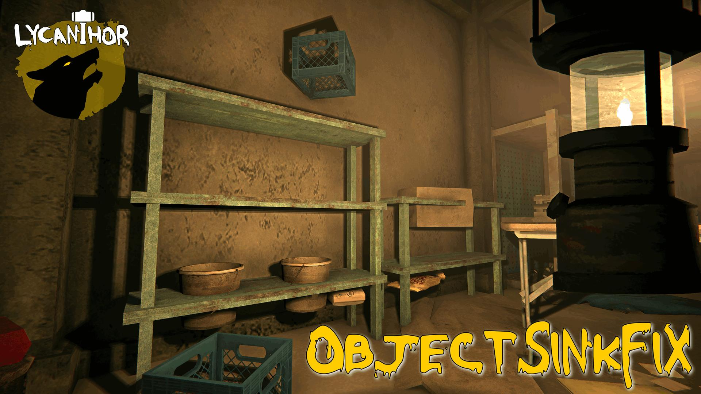

# Object Sink Fix

A mod for *The Long Dark* that fixes furniture sinking into floors and the ground, and containers vanishing when you return to a location. It also brings back containers the bug already took.

## What it does

- **Stops furniture sinking.** Shelves, safes and lockers stay where they belong.
- **Puts sunken furniture back.** Anything that already sank is restored when you enter the location. This works on existing saves.
- **Stops containers vanishing.** Safes, sacks and storage boxes no longer disappear when a location reloads.
- **Brings lost containers back.** A container the bug already removed from your save returns when you enter the location, with whatever it still held.

It works automatically. There is one optional setting, described below.

[Download the latest release](../../releases/latest)

## Requirements

- *The Long Dark* 2.55
- [MelonLoader](https://github.com/LavaGang/MelonLoader) 0.7.2
- [ModSettings](https://github.com/DigitalzombieTLD/ModSettings), optional, only needed for the setting below

## The optional setting

A lost container that was never searched, or that still held items, always comes back with its contents.

A lost container that was already empty is different. The game does not record whether an empty container vanished or was broken down by you, so the mod leaves those alone unless you ask. With ModSettings installed, turn on **Also restore objects you may have destroyed** under Object Sink Fix. Those containers, and a few pieces of furniture lost the same way, then come back empty. It may also bring back something you broke down on purpose; if so, just break it down again.

## Good to know

- Furniture you moved yourself, or carried in from somewhere else, is left where it is.
- Items floating in mid-air are a separate game bug and are not touched.
- When you break down furniture, the things on top of it still fall as normal. An item on a lower shelf may stay where it was; pick it up and drop it again.
- If you remove the mod, furniture and containers it already restored stay where they are.
- Only containers lost to this bug are brought back. Anything the game removes on purpose stays removed.

## More detail

[BACKGROUND.md](BACKGROUND.md) explains what causes these bugs and how the fix works.
